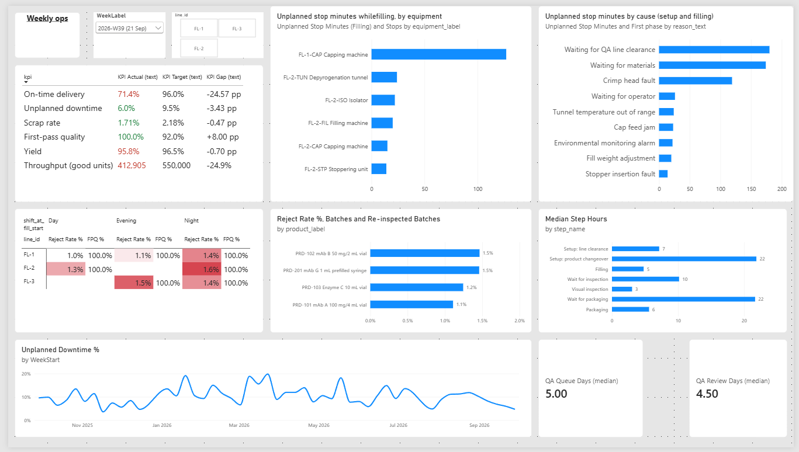
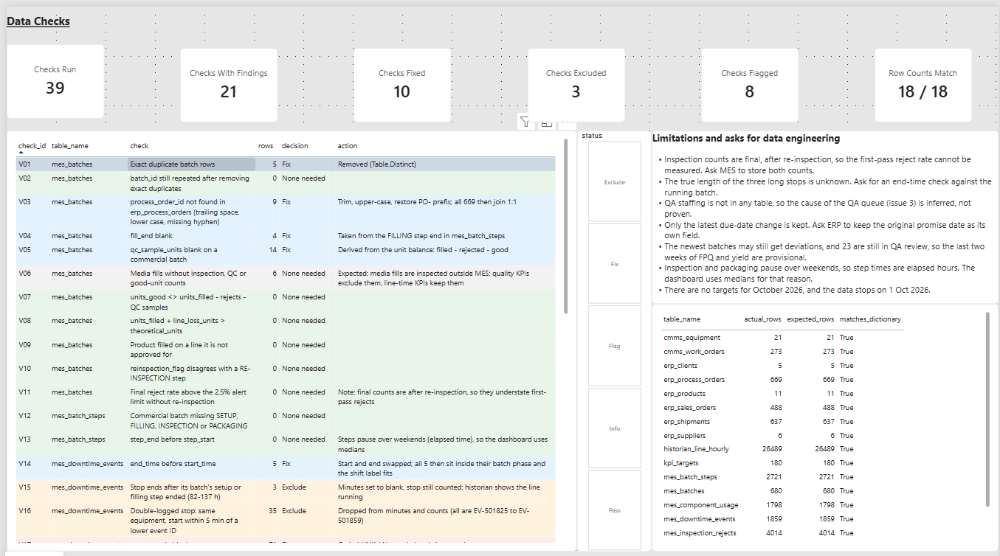
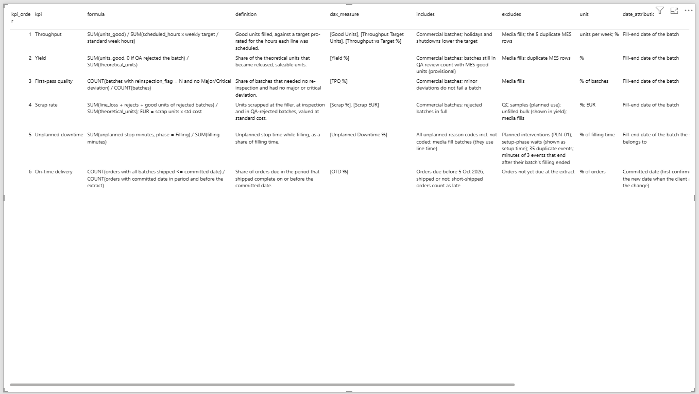
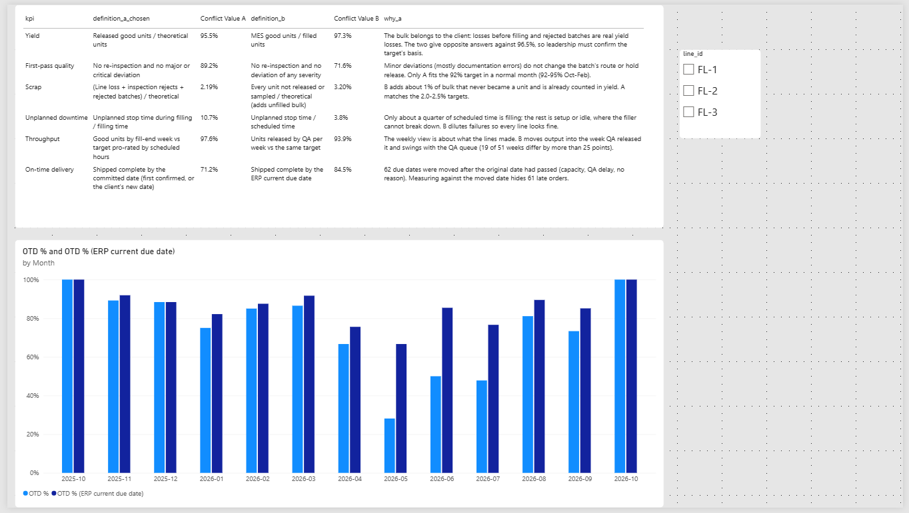
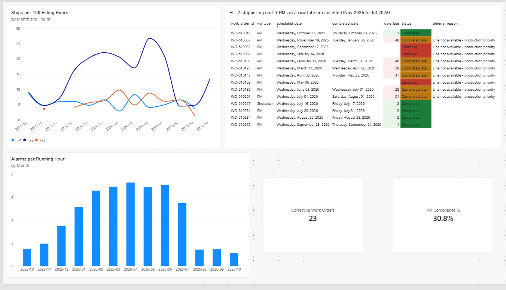
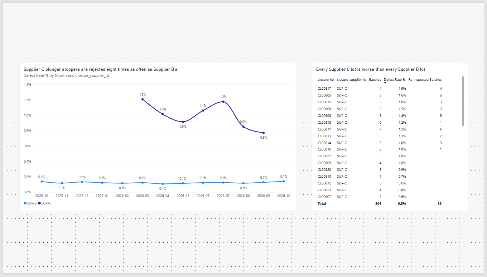
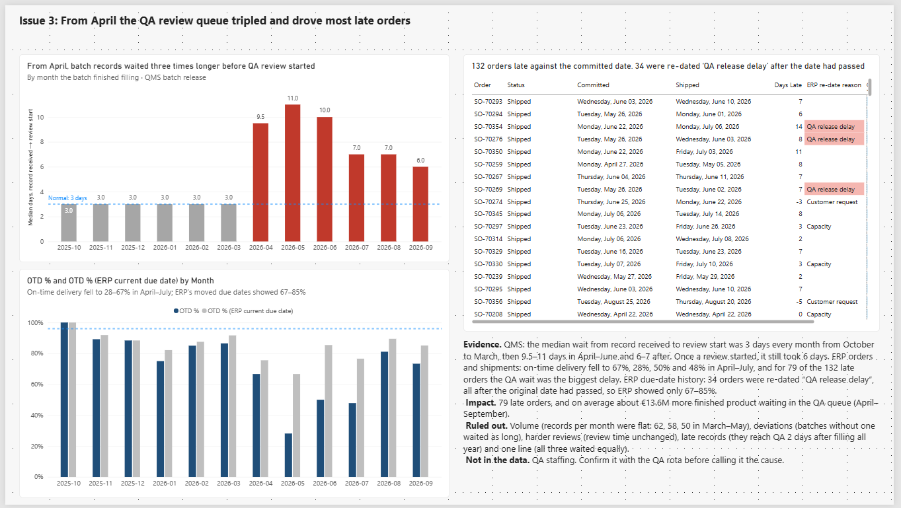

# Fill-finish site KPI dashboard (Power BI)

A weekly operations dashboard and KPI analysis for a fictional contract manufacturer that fills biologics into vials and prefilled syringes on three aseptic lines.

> **About the data.** The dataset is simulated. It was generated with an AI assistant (Claude) and data problems of the kind found in real plant data were planted on purpose and **not disclosed** to me. Finding them was part of the task. All products, clients, suppliers and people are fictional.

## What is in this repo

| Path | What it is |
| --- | --- |
| `plant_kpi_dashboard.pbix` | The Power BI file |
| `plant_kpi_dashboard.pdf` | PDF export of every page |
| `powerbi/01_PowerQuery_all_queries.m` | All Power Query (M) queries: raw loads, fixes, model tables, checks |
| `powerbi/02_DAX_measures.dax` | Every DAX measure (paste into DAX query view) |
| `powerbi/03_DAX_check_queries.dax` | Queries that reproduce the reference numbers |
| `powerbi/reference_numbers/` | Weekly and monthly KPI values to check the build against |
| `data/` | The 18 CSV extracts and the data dictionary |
| `screenshots/` | One image per report page |

## How to open it

1. Clone the repo. Open the `.pbix` in Power BI Desktop (November 2024 or later).
2. Home > Transform data > Edit parameters: set `DataFolder` to the full path of `data\` on your PC (end it with `\`).
3. Close & apply, then Refresh.

## Report pages

1. **Data checks**: 39 checks with failing-row counts and the decision for each, plus row counts against the dictionary.
2. **KPI dictionary**: formula, DAX measure, unit, sources, inclusions, exclusions, target and owner.
3. **KPI conflicts**: two reasonable definitions per KPI, both values, the one chosen and why.
4. **Weekly ops**: KPIs against target, downtime by cause and equipment, quality by line, product and shift, time per process step. Pick the week top left.
5. **Issue 1, Issue 2, Issue 3**: one page per finding, with evidence from at least two sources, the impact and the alternatives ruled out.

## KPI dictionary (short form)

| KPI | Formula | Target |
| --- | --- | --- |
| Throughput | Good units by fill-end week ÷ (scheduled hours × weekly target ÷ standard week hours) | FL-1 220k, FL-2 180k, FL-3 90k → 150k/week from Mar 2026 |
| Yield | Released good units ÷ theoretical units (rejected batch = 0) | 96.5% |
| First-pass quality | Batches with no re-inspection and no major/critical deviation ÷ batches | 92% |
| Scrap rate | (Line loss + inspection rejects + rejected batches) ÷ theoretical units; € at standard cost | 2.0 / 2.5 / 2.0% |
| Unplanned downtime | Unplanned stop minutes while filling ÷ filling minutes | 9 / 10 / 9% |
| On-time delivery | Orders shipped complete by the committed date ÷ orders due | 95–96% |

Committed date = first confirmed date, or the new date when the client asked for the change. Full definitions are on the KPI dictionary page.

## Data checks: what I found and did

| Problem | Rows | Decision |
| --- | --- | --- |
| Duplicate batch rows in MES | 5 | Removed |
| Process order keys with spaces, lower case or no hyphen | 9 | Normalised |
| Missing fill end / QC sample count | 4 / 14 | Derived from steps / unit balance |
| Downtime stops ending before they start | 5 | Start and end swapped |
| Downtime stops lasting 82–137 h, past the end of their batch | 3 | Minutes excluded (historian shows the line running) |
| Double-logged downtime stops | 35 | Excluded |
| Stops without a reason code | 71 | Kept as "Not coded" |
| Defect code STOP used for two different components | 1 code | Split into STOP-V and STOP-S |
| Shipments without a batch | 4 | Recovered from order and quantity |
| Due dates moved after the original date had passed | 62 | OTD measured on the committed date |
| Due-date changes without a reason | 13 | Treated as not client-requested |
| Release decision dated before the review started | 3 | Excluded from QA lead time |
| Deviation batch IDs without zero padding | 3 | Padded |
| Historian timestamps in UTC | all | Converted to Copenhagen time |
| Historian fill weight in mg (FL-1, from May 2026) | 524 | Divided by 1,000 |
| Historian gap on FL-3 (9–12 Feb 2026) | 79 h | Flagged |
| Production data ends 1 Oct 2026 though the lines were scheduled to 3 Oct | 6 line-days | Schedule cut at 1 Oct |

The full list (39 checks, including the ones that passed) is on the Data checks page.

## Findings

1. **FL-2 stoppering unit after deferred maintenance.** Nine 4-weekly PMs in a row (Nov 2025–Jul 2026) were deferred or cancelled for production priority. Stopper stops tripled, adding about 106 hours of downtime (about 590,000 units of capacity), 10 major deviations, 1 rejected batch (€0.63M) and 10 late orders. Back to normal after the July overhaul.
2. **Supplier C plunger stoppers on FL-3.** Since 16 Mar 2026, batches with Supplier C stoppers show 8× the stopper-defect rate of Supplier B. They account for all 33 re-inspections and 33 deviations and about 19,900 extra rejected syringes (€0.66M).
3. **QA batch-record queue since April 2026.** Waiting time before review tripled with no rise in volume. On-time delivery fell to 28–67% (Apr–Jul) and the queue drove 79 of 132 late orders. Re-dating 34 of them hid this in ERP.

## Now what

Each finding gets one action, one owner and one KPI with a trigger, so the weekly review can tell whether the action worked.

| Finding | Action | Owner | KPI to watch (trigger) |
| --- | --- | --- | --- |
| 1. FL-2 stopper PMs deferred | Make PMs on A-critical equipment non-deferrable without site-head sign-off, book PM windows in the production plan, and root-cause the bowl and feed jams with the supplier of the stoppering unit | Maintenance manager, with Production planning | FL-2 unplanned downtime % (≤ 10%); PM compliance on A-critical equipment (≥ 95%); FL-2 stopper stops per 100 filling hours (≤ 7) |
| 2. Supplier C plunger stoppers | Open a supplier corrective action with Supplier C, move volume back to Supplier B until C's lots meet the B level, and tighten incoming inspection on C lots | Quality (supplier quality), with Procurement | FL-3 STOP-S defect rate (≤ 0.15% of filled units); re-inspections per month (0); FL-3 FPQ (≥ 92%) |
| 3. QA review queue | Confirm reviewer capacity since April, add temporary reviewers until the queue is back to 3 days, and run a daily board of records waiting with their order due dates | Head of QA | Median QA queue days (≤ 3); records waiting at week end (≤ 7); OTD % against the committed date (≥ 96%) |
| Reporting | Report OTD on the committed date, keep the original promise date in ERP, and require a reason for every due-date change | Supply Chain manager | Orders re-dated after the due date had passed (0 per month) |

The triggers come from the data: 7 stopper stops per 100 hours and 3 days of QA queue are the levels before each problem started, and 0.15% is just above Supplier B's 0.12%.

## Limitations and asks for data engineering

- Final inspection counts are after re-inspection; store first-pass rejects too.
- Make reason codes, due-date change reasons and the shipment batch mandatory.
- Keep the original promise date as its own ERP field.
- State the time zone of every extract; fix the historian fill-weight unit.
- QA staffing is not in the data, so the cause of the QA queue is inferred, not proven.

## Screenshots

The Weekly ops page is at the top. The other pages:

**Data checks**

**KPI dictionary**

**KPI conflicts**

**Issue 1: FL-2 stoppering unit after deferred maintenance**

**Issue 2: Supplier C plunger stoppers on FL-3**

**Issue 3: QA batch-record queue**

